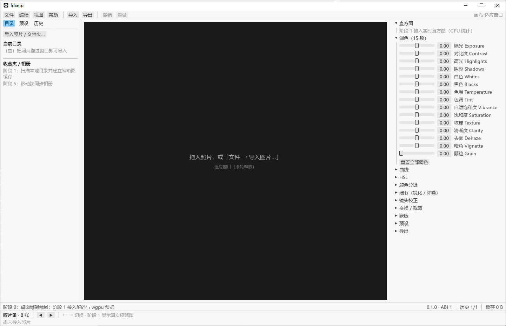
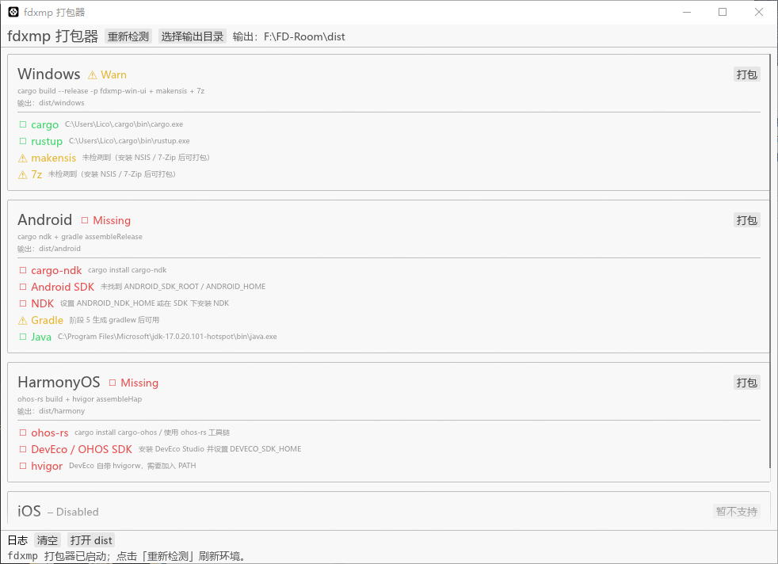
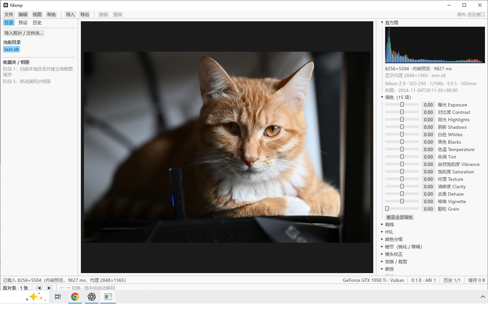
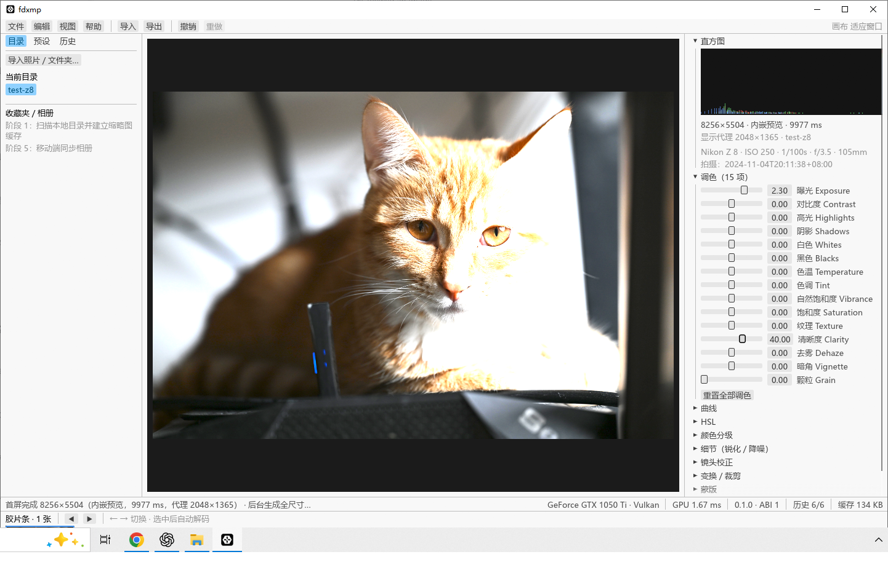

# fdxmp

跨平台专业图像处理软件（RAW 解码 / 色彩科学 / GPU 渲染），移动端完全对标 Lightroom。

本仓库是 **阶段 0（脚手架）** 的产物：Cargo workspace、全部 crate、C FFI 桥接层、
项目目录骨架、构建脚本占位与文档。

## 技术选型（已确定，不做更改）

| 领域 | 选型 |
| --- | --- |
| 核心语言 | Rust 2021 edition |
| GPU 渲染 | wgpu（Metal / Vulkan / DX12） |
| RAW 解码 | rsraw（LibRaw 封装） |
| 常见格式 | image crate + libheif-rs |
| 序列化 | serde + serde_json + zip |
| 并行 / 数组 | rayon / ndarray |
| 错误 / 异步 / 基准 | thiserror / tokio / criterion |
| 桌面 UI / 打包器 | egui + eframe（打包器单文件） |
| 移动端 UI | SwiftUI / Jetpack Compose / ArkTS |
| 移动端桥接 | JNI / ohos-rs |
| 端侧 AI | Core ML + Vision / LiteRT / XEngine Kit / ONNX Runtime |

## 目录结构

```
fdxmp/                      ← 本仓库根目录（F:\FD-Room）
├── Cargo.toml              # workspace 配置
├── crates/
│   ├── core/               # 图像处理核心（解码、色彩管线、蒙版、预设、缓存、历史）
│   ├── ffi/                # C ABI 导出层
│   ├── cli/                # 命令行测试工具
│   ├── win_ui/             # Windows UI（egui / eframe）
│   ├── android_bridge/     # Android FFI 桥接（JNI）
│   └── ohos_bridge/        # HarmonyOS FFI 桥接（ohos-rs / N-API）
├── packer_ui/              # 单文件 UI 打包器（单 main.rs）
├── platforms/              # ios / android / harmony / windows 平台工程
├── packaging/              # 打包脚本（windows / android / harmony / ios 占位）
├── dist/                   # 打包输出（windows / android / harmony / ios 占位）
├── presets/                # .fdxmp 示例预设
├── docs/                   # 架构、FFI、API、构建说明与阶段报告
└── assets/                 # 图标、测试图片
```

## 快速开始

```powershell
. .\packaging\windows\dev-env.ps1        # 本机（无 MSVC）加载 GNU 工具链；有 MSVC 可跳过
cargo fmt --all -- --check
cargo clippy --workspace --all-targets -- -D warnings
cargo test --workspace
cargo run -p fdxmp-cli -- version
cargo run -p fdxmp-win-ui          # 桌面 UI 骨架
cargo run -p fdxmp-packer-ui       # 单文件打包器
```

### 直接双击运行 exe

桌面端全功能构建 + 运行时 DLL 部署（只需做一次，之后可脱离开发环境双击运行）：

```powershell
. .\packaging\windows\dev-env.ps1
cargo build -p fdxmp-win-ui --features gpu,raw,heif
powershell -File .\packaging\windows\deploy-runtime.ps1 -Exe target\debug\fdxmp-win-ui.exe
```

之后双击 `target\debug\fdxmp-win-ui.exe`（或把照片拖到 exe 上）即可 ——
LibRaw / libheif 需要的 MinGW 运行时 DLL 会被复制到 exe 旁边，不再依赖 PATH。
发布版对 `target\release\fdxmp-win-ui.exe` 执行同一脚本即可。

可选 feature（核心）：

```powershell
cargo check -p fdxmp-core --features gpu     # wgpu 上下文
cargo check -p fdxmp-core --features raw     # rsraw（需 LibRaw 构建环境）
cargo check -p fdxmp-core --features heif    # libheif-rs（需 libheif）
cargo check -p fdxmp-core --features full    # gpu + raw + heif
```

## 文档

- [架构说明](docs/ARCHITECTURE.md)
- [FFI 桥接方案](docs/FFI.md)
- [API 概览](docs/API.md)
- [构建说明](docs/BUILD.md)
- [需求规格（冻结版）](docs/SPEC.md)
- [阶段 0 报告](docs/STAGE0_REPORT.md)
- [项目总报告 PROJECT_REPORT](PROJECT_REPORT.md)

## 阶段 0 验证摘要

- `cargo check/build/test/clippy/fmt` 全部通过（33 个测试，0 警告）
- 产物：`fdxmp_ffi.dll`（20 个 C ABI 导出）、`fdxmp-cli.exe`、
  `fdxmp-win-ui.exe`、`fdxmp-packer-ui.exe`、两个移动端桥接 dll
- `gpu` feature 编译通过（wgpu 30）；`raw` / `heif` 与移动端交叉编译的环境依赖
  见 [阶段 0 报告](docs/STAGE0_REPORT.md) §4

### 现在就能看到 / 操作的界面

```powershell
cargo run -p fdxmp-win-ui       # 主界面骨架（三大 Tab）
cargo run -p fdxmp-packer-ui    # 单文件打包器
```

| 界面 | 截图 | 能看到什么 |
| --- | --- | --- |
| Windows 主界面 |  | Lightroom Classic 式桌面布局：菜单栏 / 左栏（目录·预设·历史）/ 画布 / 右栏（直方图 + 15 项调色 + 各面板）/ 胶片条 / 状态栏；支持拖放导入、滚轮缩放、Ctrl+Z、Tab 隐藏面板 |
| 打包器 |  | Windows / Android / HarmonyOS / iOS 四张卡片；工具检测（绿 ✓ / 红 ✗ / 黄 ⚠）；打包按钮与实时日志；iOS 显示「暂不支持」 |

> 说明：阶段 0 的界面是**骨架**——还没有图片显示、解码和调色渲染（阶段 1/2 接入）。
> Windows 端采用桌面布局而非移动端三 Tab（三 Tab 是移动端规格），设计见
> [docs/DESKTOP_UI.md](docs/DESKTOP_UI.md)。

## 阶段 1 验证摘要

- RAW（rsraw/LibRaw）+ 常见格式统一解码；45.7MP Nikon Z8 NEF 实测：
  **首屏（内嵌预览）218ms**、全尺寸 16bit 解调 4.9s、24MP JPEG 110ms
- Windows 画布用 wgpu 后端显示解码图像（本机 `GTX 1050 Ti · Vulkan`），
  含直方图、RAW 元数据、滚轮缩放、拖拽平移、后台线程解码
- HEIF（libheif 1.23）已接入并验证；首屏后自动后台渲染全尺寸；
  批量导入用 rayon 并行生成缩略图并写入磁盘缓存
- 细节见 [阶段 1 报告](docs/STAGE1_REPORT.md)



## 阶段 2 验证摘要

- 15 项调色 + 曲线 + HSL + 颜色分级 + 细节全部由 **wgpu compute** 实现（三趟：两趟模糊 + 主调色）
- 桌面端实时预览：**5.4 ms/帧 @2048×1365 ≈ 185 fps**（目标 ≥30fps）；滑块拖动实时生效，松手才记一步历史
- 7 项 GPU 集成测试验证数学正确性；细节见 [阶段 2 报告](docs/STAGE2_REPORT.md)



## 开发阶段

| 阶段 | 内容 | 状态 |
| --- | --- | --- |
| 0 | 脚手架：workspace / crate / FFI 可行性 | ✅ 已完成 |
| 1 | 核心解码与 GPU 显示 | ✅ 已完成（[阶段 1 报告](docs/STAGE1_REPORT.md)） |
| 2 | 色彩管线（曲线 / HSL / 分级 / 细节） | ✅ 已完成（[阶段 2 报告](docs/STAGE2_REPORT.md)） |
| 3 | 蒙版系统（画笔 / 渐变 / 范围 / AI） | ✅ 已完成（[阶段 3 报告](docs/STAGE3_REPORT.md)，AI 蒙版接口预留） |
| 4 | 预设与导出（.fdxmp / XMP 导入） | ✅ 已完成（[阶段 4 报告](docs/STAGE4_REPORT.md)） |
| 5 | 移动端 UI（三大 Tab + 编辑界面） | 🟡 三端设备 Tab 已实现；Android 编辑 Tab + 基础调色编辑界面（Rust 核心出预览）已实现；曲线 / HSL / 蒙版与其余两端编辑界面待做 |
| 6 | Windows UI 与打包器 | ⏳ 待开始 |
| 7 | AI 蒙版与性能优化 | ⏳ 待开始 |
