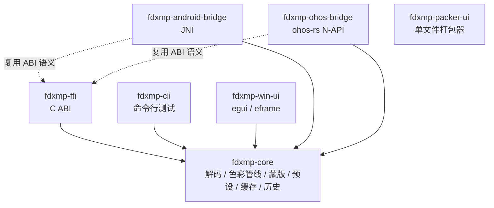
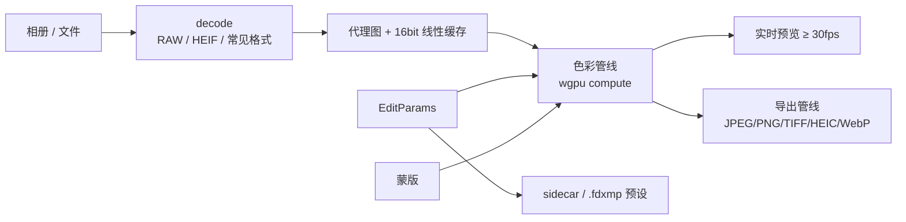

# fdxmp 架构说明

## 0. 仓库根目录说明

规格文档中的项目根写作 `fdxmp/`；本仓库实际根目录为 `F:\FD-Room\`，
内部目录结构与规格完全一致（`crates/`、`platforms/`、`packaging/`、
`dist/`、`presets/`、`docs/`、`assets/`、`packer_ui/`）。
如需严格同名目录，整体重命名仓库根即可，不影响任何配置。

## 1. crate 依赖图

四端（Windows / Android / HarmonyOS / iOS）都只依赖 `fdxmp-core` 的稳定接口；
平台桥接层不复制业务逻辑。

## 2. 模块职责

| 模块 | 文件 | 职责 |
| --- | --- | --- |
| 参数模型 | `crates/core/src/params.rs` | 15 项调色滑块、曲线、HSL、颜色分级、细节、镜头、变换、裁剪、蒙版参数树 |
| 预设 | `crates/core/src/preset.rs` | `.fdxmp`（JSON + ZIP + LUT）读写、schema 版本校验、XMP 导入入口（阶段 4） |
| 解码 | `crates/core/src/decode.rs` | 魔数嗅探、常见格式（image crate）、RAW（rsraw）、HEIF（libheif-rs） |
| 色彩管线 | `crates/core/src/pipeline.rs` | 15 阶段顺序定义 + CPU 参考实现（阶段 2 替换为 wgpu compute） |
| GPU | `crates/core/src/gpu.rs` | wgpu 设备 / 队列（`gpu` feature） |
| 蒙版 | `crates/core/src/masks.rs` | 蒙版类型与生成器接口（阶段 3） |
| 历史 | `crates/core/src/history.rs` | 撤销 / 重做 / 跳转 / 快照 |
| 缓存 | `crates/core/src/cache.rs` | 缩略图 / 预览 / AI 模型缓存的大小统计与清除 |
| 导出 | `crates/core/src/export.rs` | 导出格式、尺寸、色彩空间、元数据、水印设置（阶段 4） |
| 引擎 | `crates/core/src/lib.rs` | `Engine`：参数 + 历史 + 缓存的门面 |
| C ABI | `crates/ffi/src/lib.rs` | 四端统一 FFI（字符串 / 字节缓冲区所有权、错误模型、panic 捕获） |

## 3. 数据流

## 3.1 界面分工（桌面 vs 移动）

| 端 | 交互范式 | 设计文档 |
| --- | --- | --- |
| Windows | Lightroom Classic 式桌面布局（多面板 / 快捷键 / 多窗口） | `docs/DESKTOP_UI.md` |
| Android / HarmonyOS / iOS | Lightroom Mobile 式三 Tab + 底部弹出面板（规格严格要求） | `docs/SPEC.md` 移动端流程 |

两端功能集合一致，差异只在本文件「数据流」之外的呈现层；核心与预设格式共用。

## 4. 线程与生命周期

- UI 线程：仅做界面与参数交互，不执行解码 / 渲染。
- 解码线程池：rayon 并行（RAW 解压、缩放、降噪）。
- GPU 线程：wgpu 设备与队列由 `fdxmp-core` 持有，UI 提交渲染任务。
- 参数写入：任何调整都经过 `Engine::apply` / `apply_json`，自动进入历史栈。
- 退出时：把当前 `EditParams` 写入 sidecar 文件（阶段 4 完成序列化落盘）。

## 5. 冷启动预算（性能目标）

| 指标 | 目标 | 手段 |
| --- | --- | --- |
| 冷启动 | < 2s | 核心库最小初始化、缩略图缓存预热、延迟加载 AI 模型 |
| 24MP RAW 首屏 | < 2s | 嵌入预览优先 + 并行解码管线 |
| 实时预览 | ≥ 30fps | wgpu compute、代理图分块、低端设备降级 |

## 6. 阶段路线

阶段 0（本文件所在阶段）→ 阶段 7 的路线见 `docs/SPEC.md`「开发阶段」。
每个阶段结束输出报告：已完成 / 测试结果 / 性能 / 遗留问题。
