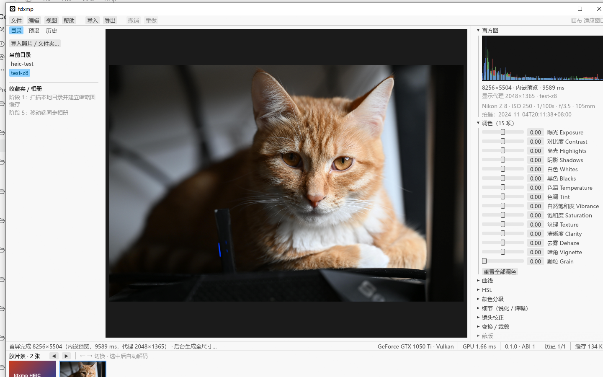

# fdxmp 构建说明

## 0. 环境要求

| 目标 | 要求 |
| --- | --- |
| 通用 | Rust stable（本仓库 `rust-toolchain.toml` 指定 stable + rustfmt + clippy） |
| Windows | MSVC 工具链（`x86_64-pc-windows-msvc`）**或** GNU 工具链 + MinGW-w64（本机当前方案，见 §0.1） |
| Android | Android SDK、NDK、JDK 17+、`cargo-ndk`、Gradle |
| HarmonyOS | DevEco Studio（`DEVECO_SDK_HOME`）、`hvigorw`、ohos 目标工具链 |
| iOS（占位） | macOS + Xcode（暂不打包） |

### 0.1 本机 Windows 方案（无 Visual Studio 时的替代）

该机器未安装 Visual Studio / Windows SDK，因此使用 Rust 自带的 GNU 宿主工具链
加一份本地 MinGW-w64（gcc + dlltool + as）：

1. 安装 GNU 宿主工具链（自带 rust-mingw 链接器）：

   ```powershell
   rustup toolchain install stable-x86_64-pc-windows-gnu --profile minimal
   ```

2. 准备 MinGW-w64 工具链（MSYS2 组件，解压即用，放在用户缓存目录，不进入仓库）：

   ```text
   %USERPROFILE%\.cache\fdxmp-tools\mingw64\bin   # gcc.exe / dlltool.exe / as.exe / ld.exe ...
   %USERPROFILE%\.cache\fdxmp-tools\pylibs        # zstandard（解包 .tar.zst 用）
   ```

   需要的最小包：binutils、gcc、libgcc、libstdc++、gmp、mpfr、mpc、isl、
   headers、crt、winpthreads、zstd、windows-default-manifest、libiconv、gettext、zlib。
   下载源：`https://mirrors.tuna.tsinghua.edu.cn/msys2/mingw/mingw64/`
   （`.pkg.tar.zst` 用 Python `zstandard` 解压为 `.tar` 后再用 `tar -xf` 展开）。

3. 每个新终端先加载环境：

   ```powershell
   . .\packaging\windows\dev-env.ps1
   cargo test --workspace
   ```

## 1. 项目初始化命令（阶段 0 实际执行）

```powershell
cd F:\FD-Room
git init
cargo new --lib crates/core --name fdxmp-core
cargo new --lib crates/ffi --name fdxmp-ffi
cargo new --bin crates/cli --name fdxmp-cli
cargo new --bin crates/win_ui --name fdxmp-win-ui
cargo new --lib crates/android_bridge --name fdxmp-android-bridge
cargo new --lib crates/ohos_bridge --name fdxmp-ohos-bridge
cargo new --bin packer_ui --name fdxmp-packer-ui
# 随后按规格改写 workspace / 各 crate 的 Cargo.toml 与源码
```

## 2. 日常开发

```powershell
cargo fmt --all
cargo clippy --workspace --all-targets -- -D warnings
cargo test --workspace
cargo bench -p fdxmp-core            # criterion 基准
cargo run -p fdxmp-cli -- version
cargo run -p fdxmp-win-ui
cargo run -p fdxmp-packer-ui
```

> 无 MSVC 的机器请先执行 `. .\packaging\windows\dev-env.ps1`，再运行上述命令
> （脚本会切换到 GNU 宿主工具链并注入 MinGW-w64 的 PATH）。

## 3. feature 组合

```powershell
cargo check -p fdxmp-core --features gpu
cargo check -p fdxmp-core --features raw
cargo check -p fdxmp-core --features heif
cargo check -p fdxmp-core --features full
```

`raw` 需要 LibRaw 的构建环境；`heif` 需要 libheif（Windows 建议用 vcpkg 安装
`libheif` 并设置 `LIBHEIF_DIR` / `VCPKG_ROOT`）。两者失败时的报错会明确指向缺失的本地库。

具体到本机（阶段 0 实测）：

- `raw`（rsraw-sys）需要 **libclang**（bindgen）+ MinGW 头文件；仅 PyPI 的
  `libclang` + MSYS2 头文件会在 `stdlib.h` 处报错，建议安装完整 LLVM/Clang
  （`winget install LLVM.LLVM`）或 MSYS2 的 `mingw-w64-x86_64-clang`。
  `rsraw-sys` 不支持 MSVC，必须使用 GNU/MinGW 编译器。
- `heif`（libheif-sys）需要 `pkg-config` 与 **libheif ≥ 1.23**：
  `pkg-config --libs --cflags libheif` 必须可用。

### RAW 构建环境（本机已打通，阶段 1 实测）

`rsraw-sys` 用 bindgen 生成 LibRaw 绑定，本机配方已固化进 `dev-env.ps1`：

```powershell
$env:LIBCLANG_PATH = "$env:USERPROFILE\.cache\fdxmp-tools\pylibs\clang\native"   # PyPI libclang
$env:CPATH = "$env:USERPROFILE\.cache\fdxmp-tools\mingw64\include;$env:USERPROFILE\.cache\fdxmp-tools\mingw64\lib\gcc\x86_64-w64-mingw32\16.2.0\include"
$env:BINDGEN_EXTRA_CLANG_ARGS = "--target=x86_64-w64-windows-gnu"
cargo build -p fdxmp-win-ui --features raw
```

阶段 2 起桌面端推荐构建命令（GPU 实时调色 + RAW + HEIF 全开）：

```powershell
cargo build --release -p fdxmp-win-ui --features gpu,raw,heif
```

说明：`cargo build --workspace`（不带特性）不会启用 GPU —— 两个移动端桥接 crate 是
`cdylib`，在 MinGW 下链接 wgpu 时符号过多会触发 `export ordinal too large`。
因此 GPU 是 UI 的可选特性（默认关），打包脚本显式开启。

注意：

- LibRaw 是 C++，生成的 exe 需要 `libstdc++-6.dll`、`libgcc_s_seh-1.dll`、
  `libwinpthread-1.dll`（`packaging/windows/build.ps1` 会自动复制到 `dist/`）；
- `rsraw-sys` 不支持 MSVC 编译器，必须使用 GNU/MinGW 工具链；
- 构建产物可直接运行：`target\debug\fdxmp-win-ui.exe [照片路径]`。

### 让 exe 可以双击运行（不依赖 dev-env 的 PATH）

LibRaw / libheif 都是 C/C++，exe 需要一批 MinGW 运行时 DLL。执行一次部署脚本即可：

```powershell
powershell -File packaging\windows\deploy-runtime.ps1 -Exe target\debug\fdxmp-win-ui.exe
```

脚本用 `objdump` 递归解析导入表，把缺失的 DLL（libheif / libde265 / libaom /
libstdc++ / libcryptopp 等，实测 19 个）复制到 exe 旁边；复制后双击即可运行，
HEIC 与 RAW 都能打开。打包脚本 `build.ps1` 对 `dist/windows/` 做同样处理。



### HEIF 构建环境（本机已打通，阶段 1 实测）

`libheif-sys` 通过 pkg-config 查找 libheif（要求 ≥ 1.23）。本机配方：

```powershell
# MSYS2 包（TUNA 镜像）解压到 %USERPROFILE%\.cache\fdxmp-tools\mingw64：
#   libheif、libde265、aom、dav1d、kvazaar、x265、svt-av1、rav1e、openh264、
#   openjpeg2、openjph、libjpeg-turbo、libwebp(含 libsharpyuv)、libtiff、
#   libdeflate、lerc、jbigkit、xz、zlib、crypto++、pkgconf
$env:PKG_CONFIG_PATH = "$env:USERPROFILE\.cache\fdxmp-tools\mingw64\lib\pkgconfig"
pkg-config --modversion libheif        # 1.23.5
cargo check -p fdxmp-core --features heif
cargo build -p fdxmp-win-ui --features raw,heif
```

运行时：libheif 及编解码器 DLL 由打包脚本按导入表自动收集；
本地调试时 `dev-env.ps1` 已把 `mingw64\bin` 加入 PATH。

## 4. 各平台打包

```powershell
powershell -File packaging/windows/build.ps1
powershell -File packaging/android/build.ps1
powershell -File packaging/harmony/build.ps1
```

输出统一落在 `dist/{windows,android,harmony,ios}/`。
iOS 按规格占位，不打包。

## 5. 桌面打包器

```powershell
cargo run -p fdxmp-packer-ui
```

界面功能：各平台工具检测（绿 ✓ / 红 ✗ / 黄 ⚠）、一键打包、实时日志、
iOS 按钮禁用（「暂不支持」）、输出目录选择（默认 `dist/`）。

## 6. 已知限制（阶段 0）

- Android / HarmonyOS 交叉编译需要先安装 SDK / NDK / DevEco，当前环境未安装；
- `napi-ohos`（ohos-rs）需在可访问 GitHub git 的环境启用，见 `crates/ohos_bridge/README.md`；
- `raw`（LibRaw）、`heif`（libheif）需要本地原生库，默认 feature 关闭；
- 平台工程（Gradle / DevEco）在阶段 5 生成，打包脚本已就绪但暂不可完整执行。
